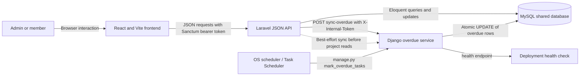

# TaskFlow Architecture and Request Flows

## System architecture

The application has three separately deployable components. React is the user interface, Laravel owns authentication and normal project/task APIs, and Django performs overdue-task sweeps. Laravel and Django share the same MySQL database.

## Responsibilities

| Component | Main responsibility | Entry points |
| --- | --- | --- |
| React frontend | Login, projects, project details, My tasks, People, task creation and status changes | App.jsx and api.js |
| Laravel API | Login/register, Sanctum tokens, role/ownership checks, validation, project/task JSON responses | routes/api.php and app/Http/Controllers |
| MySQL | Users, Sanctum tokens, projects and tasks; the authoritative application data | Laravel migrations |
| Django service | Idempotently mark past-due unfinished tasks OVERDUE | /api/tasks/sync-overdue/ and mark_overdue_tasks command |
| Scheduler | Run Django overdue processing on a recurring interval | cron or Windows Task Scheduler |

## Frontend function map

- Sign in: Login submits email and password to POST /api/login. Laravel validates credentials, creates a Sanctum token, and returns the token with the user. React stores the token in localStorage.
- Session restore: On app startup, React calls GET /api/me with the bearer token. The returned user determines the current role and visible actions.
- Sign out: React calls POST /api/logout. Laravel revokes the current token, and React clears its local token and user state.
- Projects navigation: GET /api/projects returns projects with visible tasks, creator data and a task count. Admins see all projects/tasks. Members only see projects and tasks assigned to them.
- Project selection: GET /api/projects/{id} loads the selected project and its tasks. Laravel runs the overdue sync first, then applies the same role-based visibility.
- Project search: Search is performed client-side against the project list already loaded by React.
- Create project: Admin submits POST /api/projects. StoreProjectRequest validates the fields; ProjectController stores the project with the admin as creator.
- My tasks: React filters the already-loaded project task data by the current user's id. Each row includes its project name. Status changes use the same authenticated task update API.
- People: GET /api/users returns the authenticated workspace directory's names, email addresses and roles. The same endpoint provides assignee choices in the admin task form.
- Create task: An admin opens the form; React requests GET /api/users for assignees, then submits POST /api/projects/{id}/tasks. StoreTaskRequest validates the task and Laravel associates it with the selected project.
- Change task status: React sends PATCH /api/tasks/{id}. Laravel validates the requested status, checks assignment/role and overdue rules, saves the task, then React refreshes project and task data.
- Overdue task closure: A member cannot close an overdue task. An admin may set it to DONE; the overdue task row exposes a close action.
- Other UI actions: Help and Explore plans currently show local informational toasts. They do not call external services.

## API request flow

1. React's api.js adds Accept and Content-Type headers and, when signed in, Authorization: Bearer <token>.
2. Laravel routes the request and applies auth:sanctum to protected endpoints.
3. Request classes validate login, registration, project creation, task creation or task status input where applicable.
4. Controllers query or update Eloquent models. Responses use the common JSON shape { "data": ... }; validation and authorization failures return an HTTP error with a message.
5. React unwraps the data field, updates its state and renders the new view. Errors are shown in the relevant form or inline error area.

## Overdue task process

1. The recurring OS scheduler invokes python manage.py mark_overdue_tasks in the Django project.
2. Django opens an atomic database transaction and updates rows where due_date is earlier than the current UTC date, status is not DONE and status is not already OVERDUE.
3. The update is idempotent: subsequent runs do not change already-overdue rows, and completed tasks remain completed.
4. Laravel also calls the protected Django POST /api/tasks/sync-overdue/ endpoint before project list/detail reads. It sends X-Internal-Token. Django uses a constant-time token comparison before running the same transition.
5. Task status updates pass through Laravel's OverdueTaskService. It blocks moving overdue tasks back to IN_PROGRESS and allows only admins to move overdue tasks to DONE.
6. If Django is temporarily unavailable during a Laravel project read, Laravel reports the exception and continues serving the read. The scheduled Django command is the reliable recurring fallback.

## Authorization and visibility

- Admins can view all projects and tasks and can create projects and assign tasks.
- Members can see only projects containing tasks assigned to them and can update only their own task statuses.
- The People directory is available to authenticated users and returns basic workspace profile fields only.
- The Django sync endpoint is service-to-service only and requires the shared internal token.
- The overdue rules are enforced both by the scheduled Django process and by Laravel when a user requests a status transition.

## Deployment topology

Deploy React, Laravel and Django as three independent services/repositories. Configure Laravel and Django with the same MySQL database. Keep Django's internal sync endpoint private where possible, set the same strong OVERDUE_SYNC_TOKEN in Laravel and Django, and configure the scheduler to run the overdue command periodically. Set the React API base URL to the deployed Laravel API. The assignment requires both backend and frontend deployment; the three repository deliverables are separate React, Laravel and Django repositories.

